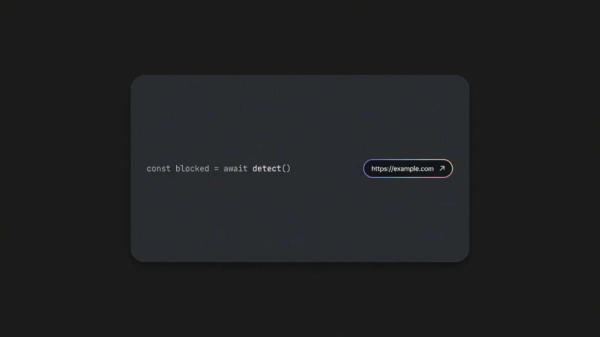

<p align="center">
  
</p>

<h1 align="center">Plainly</h1>

<p align="center">
  <strong>Coded text → plain text you can read.</strong><br />
  Works on Reddit right away. Add other websites from the menu.
</p>

<p align="center">
  <a href="https://github.com/27mfp/plainly"></a>
  
  
</p>

<p align="center">
  
</p>

---

## What it does

Some posts hide links or messages as long coded strings. **Plainly** finds them and shows the readable version next to the code.

- Works automatically on Reddit  
- You can add more sites yourself  
- If the plain text is a link, you can open it  
- Copy with one click  
- Nothing is sent to any server — see [PRIVACY.md](./PRIVACY.md)

## Example

```text
aHR0cHM6Ly9tZWdhdHVnYS5pby8=
```

Plainly shows: `https://megatuga.io/`

## Install

1. Open Chrome → `chrome://extensions`  
2. Turn on **Developer mode**  
3. Click **Load unpacked** and pick this folder  
4. Open Reddit (or a site you added) and **refresh** the tab  

Pin Plainly from Chrome’s puzzle menu if you want the icon always visible.

**Code:** [github.com/27mfp/plainly](https://github.com/27mfp/plainly)

## How to use

| Want to… | Do this |
| --- | --- |
| Read plain text | Look for the grey tag next to a coded line |
| Open a link | Click the address in the tag |
| Copy the plain text | Click the copy icon on the tag |
| Use the site you’re on | Open the popup → **Add this site** → allow → **refresh** |
| Add another site | Popup → type `example.com` → **Add** → allow → **refresh** |
| Remove a site | Popup → **×** next to the name |
| Turn Plainly off | Popup → **On** switch |
| Check a code by hand | Paste it under **Try a code** |

## For developers

```bash
npm test
npm run icons
```

```text
plainly/
├── manifest.json      Chrome extension settings
├── icons/             App icons
├── docs/              Screenshot
├── src/               Extension code
├── popup.*            Toolbar menu
└── test/              Tests and local preview page
```

How to contribute: [CONTRIBUTING.md](./CONTRIBUTING.md)

## Privacy & security

- No tracking, no accounts, no remote servers  
- Reddit works out of the box; other sites only after you allow them  
- Saves only: on/off, and the site list you added  

[Privacy](./PRIVACY.md) · [Security](./SECURITY.md) · [License (MIT)](./LICENSE)
