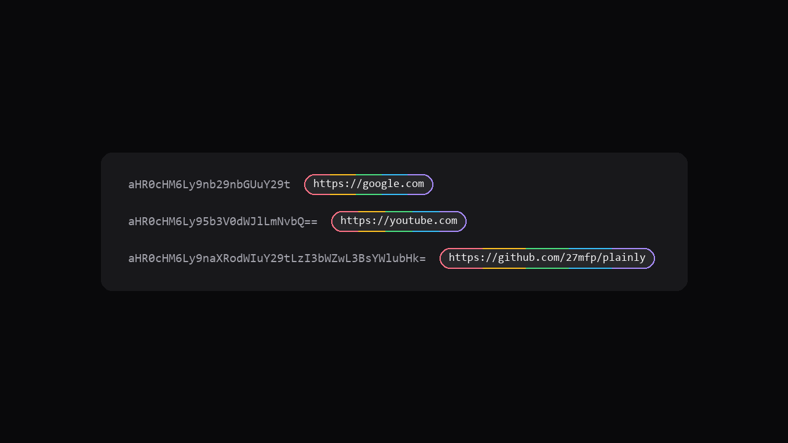

<p align="center">
  
</p>

<h1 align="center">Plainly</h1>

<p align="center">
  <strong>Texto codificado → texto simples que consegues ler.</strong><br />
  Funciona no Reddit de imediato. Podes adicionar outros sites no menu.
</p>

<p align="center">
  <a href="./README.md">English</a>
  ·
  <a href="https://github.com/27mfp/plainly">GitHub</a>
</p>

<p align="center">
  
</p>

---

## O que faz

Alguns posts escondem links ou mensagens em códigos longos. O **Plainly** encontra-os e mostra a versão legível ao lado.

- Funciona sozinho no Reddit  
- Podes acrescentar mais sites  
- Se o texto for um link, podes abri-lo  
- Copiar com um clique  
- Nada é enviado para servidores — ver [PRIVACY.md](./PRIVACY.md)

## Exemplo

O endereço deste projeto, em código:

```text
aHR0cHM6Ly9naXRodWIuY29tLzI3bWZwL3BsYWlubHk=
```

O Plainly mostra: `https://github.com/27mfp/plainly`

## Instalar

1. Abre o Chrome → `chrome://extensions`  
2. Liga o **Modo de programador**  
3. Clica em **Carregar expandida** e escolhe esta pasta  
4. Abre o Reddit (ou um site que tenhas adicionado) e **atualiza** o separador  

Podes fixar o Plainly no menu do puzzle do Chrome.

**Código:** [github.com/27mfp/plainly](https://github.com/27mfp/plainly)

## Como usar

| Queres… | Faz isto |
| --- | --- |
| Ler o texto simples | Procura a etiqueta cinzenta ao lado do código |
| Abrir um link | Clica no endereço na etiqueta |
| Copiar | Clica no ícone de copiar |
| Usar o site em que estás | Menu → **Add this site** → permitir → **atualizar** a página |
| Adicionar outro site | Menu → escreve `example.com` → **Add** → permitir → **atualizar** |
| Remover um site | Menu → **×** ao lado do nome |
| Desligar | Menu → interruptor **On** |
| Testar um código à mão | Cola em **Try a code** |

## Para programadores

```bash
npm test
npm run icons
```

Como contribuir: [CONTRIBUTING.md](./CONTRIBUTING.md)  
README em inglês: [README.md](./README.md)

## Privacidade e segurança

- Sem tracking, sem contas, sem servidores remotos  
- O Reddit vem incluído; outros sites só depois de autorizares  
- Guarda só: ligado/desligado e a lista de sites  

[Privacidade](./PRIVACY.md) · [Segurança](./SECURITY.md) · [Licença (MIT)](./LICENSE)
